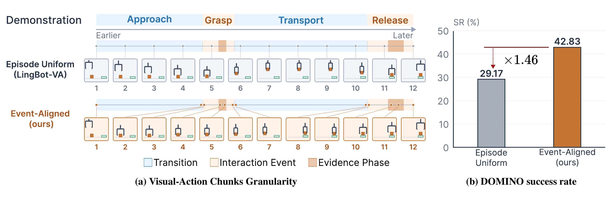

<h1 align="center">Event-Aligned Visual Action Reasoning<br>for World Action Models</h1>

<!-- <p align="center">
  <b>Xiaomeng Yang, Yushu Wu, Yi Gao, Yuhao Lei, Xuan Zhang, Pu Zhao, Yanzhi Wang</b><br>
  Northeastern University
</p> -->

<p align="center">
  <a href="https://xiaomeng-yang.github.io/Event-aligned-WAM/">🌐 Project Page</a> ·
  <a href="https://huggingface.co/collections/Xun49/event-aligned">🤗 Models</a> ·
  <a href="https://arxiv.org/abs/2610.09427">📄 Paper</a>
</p>

Code for **Event-Aligned**, built on [LingBot-VA](https://github.com/Robbyant/lingbot-va). Event-Aligned organizes visual action reasoning around interaction events and predicts which action to execute.

<p align="center">
  <a href="assets/event_aligned_teaser.png"></a>
  <br>
  <em>Event-aligned visual action sampling (left). DOMINO success rates under a matched training sequence budget (right).</em>
</p>

## Release roadmap

- [x] Inference code and checkpoints.
- [ ] TODO: Release training code.
- [ ] TODO: Release dataset preparation code and the datasets.

## Installation

Clone the repository and follow [INSTALL.md](INSTALL.md) to set up the inference server and client environments:

```bash
git clone https://github.com/Xiaomeng-Yang/Event-aligned-WAM.git
cd Event-aligned-WAM
```

The server requires Python 3.10, CUDA, and the dependencies in `requirements-inference.txt`. Simulator evaluation additionally requires an existing DOMINO or RoboTwin installation with its assets and rendering dependencies. Server and client can run in separate environments.

## Models

| Benchmark | Checkpoint |
| --- | --- |
| DOMINO | [Xun49/Event-aligned-domino-clean1](https://huggingface.co/Xun49/Event-aligned-domino-clean1) |
| RoboTwin 2.0 | [Xun49/Event-aligned-robotwin](https://huggingface.co/Xun49/Event-aligned-robotwin) |

Download the model for your benchmark using the `hf` CLI from `huggingface_hub`:

```bash
hf download Xun49/Event-aligned-domino-clean1 \
    --local-dir ./model/event-aligned_domino_clean1

hf download Xun49/Event-aligned-robotwin \
    --local-dir ./model/event-aligned_robotwin
```

Each complete model directory must contain `transformer/`, `vae/`, `text_encoder/`, and `tokenizer/`. Use the matching Event-Aligned checkpoint and keep its configuration files unchanged.

## Evaluate DOMINO

Run all commands from the repository root. In the inference server environment:

```bash
CUDA_VISIBLE_DEVICES=0 bash evaluation/domino/launch_server.sh
```

In a second terminal, activate your [DOMINO](https://github.com/H-EmbodVis/DOMINO) environment and evaluate a task:

```bash
DOMINO_ROOT=/absolute/path/to/DOMINO \
    bash evaluation/domino/launch_client.sh ./outputs/domino adjust_bottle
```

Defaults: `TASK_CONFIG=demo_clean_dynamic`, `INSTRUCTION_TYPE=unseen`, and `TEST_NUM=100`. The released model uses execution-head action selection. Set `TEST_NUM=1` for a one-episode trial; append `--no-video` to disable video recording. Results, including `_metrics.json`, are saved beneath `./outputs/domino/`.

## Evaluate RoboTwin

In the inference server environment:

```bash
CUDA_VISIBLE_DEVICES=0 bash evaluation/robotwin/launch_event_aligned_server.sh
```

In a second terminal, activate your RoboTwin 2.0 environment and evaluate a task:

```bash
ROBOTWIN_ROOT=/absolute/path/to/RoboTwin \
    bash evaluation/robotwin/launch_event_aligned_client.sh \
    ./outputs/robotwin adjust_bottle
```

Defaults: `TASK_CONFIG=demo_clean`, `INSTRUCTION_TYPE=seen`, `TEST_NUM=100`, and `EXECUTION_MODE=predicted`. Results are saved beneath `./outputs/robotwin/`, with success rates in `metrics/<task>/res.json` under each seed directory.

For both benchmarks, override `MODEL_PATH` on the server or `HOST` on the client as needed. Server and client must use the same `PORT` (default `29536`). Set `VA_ENABLE_OFFLOAD=1` on the server to move VAE/text-encoder computation to CPU when GPU memory is limited.

## Image-only inference

To request an initial action chunk without a simulator, start the [DOMINO server](#evaluate-domino) and prepare three RGB images from the same observation:

```text
input_images/
├── observation.images.cam_high.png
├── observation.images.cam_left_wrist.png
└── observation.images.cam_right_wrist.png
```

In the image-client environment:

```bash
python -m pip install -r requirements-client.txt
python example/domino/client.py \
    --image-dir ./input_images \
    --prompt 'Pick up the bottle and place it on the target.' \
    --host 127.0.0.1 --port 29536 \
    --output ./outputs/initial_actions.npz
```

The example saves predicted actions and execution masks. Actions use end-effector poses relative to the initial pose; this example does not execute a robot or simulator rollout. Run the client with `--help` for more options.

## Citation

If you use Event-Aligned, please cite [our paper](https://arxiv.org/abs/2610.09427).

```bibtex
@misc{yang2026eventaligned,
  title={Event-Aligned Visual Action Reasoning for World Action Models},
  author={Yang, Xiaomeng and Wu, Yushu and Gao, Yi and Lei, Yuhao and Zhang, Xuan and Zhao, Pu and Wang, Yanzhi},
  year={2026},
  eprint={2610.09427},
  archivePrefix={arXiv},
  primaryClass={cs.CV},
  url={https://arxiv.org/abs/2610.09427}
}
```

## License and acknowledgments

The code is released under [Apache-2.0](LICENSE.txt). We thank the Robbyant Team for [LingBot-VA](https://github.com/Robbyant/lingbot-va), on which this implementation is based.

